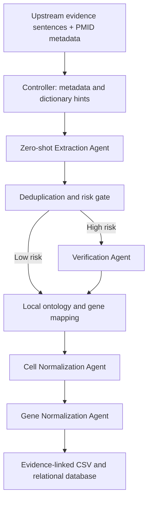

# CMAgent — Multi-Agent Curation Pipeline

Controller-guided extraction, verification, and normalization of **cell type–marker relationships** from biomedical evidence sentences.

## Scope and contribution

This repository contains the **downstream multi-agent curation component contributed by Myeongkwan Kim** to the collaborative CMAgent project. It starts with evidence sentences supplied by an upstream system.

**The preceding sentence classifier is outside this release.** Literature retrieval/ranking, classifier training and inference, label-refinement code, classifier weights, experimental scripts, ablations, evaluation datasets, and generated results are not included. The accompanying papers describe the broader collaborative system; their inclusion does not imply that all components or contributions are implemented in this repository.

The released pipeline covers relation extraction, verification, and normalization. It accepts sentence CSV files selected by the upstream classifier; experimental code and artifacts remain outside the release.

## Pipeline



- **Controller:** prepares work items, coordinates stages, checkpoints decisions, and retries incomplete work.
- **Extraction Agent:** extracts specific/broad cell mentions, marker mentions, polarity, confidence, and supporting spans using structured responses.
- **Verification Agent:** reviews candidates with risky or ambiguous context; low-risk candidates are retained without another model call. Unavailable verification uses a recorded fail-open policy and is retried within the configured cycle limit.
- **Normalization Agents:** choose from retrieved Cell Ontology or species-specific NCBI Gene candidates for mentions unresolved by local mapping. Candidate validation constrains identifiers to the supplied list.
- **Persistence:** preserves evidence, PMID, source mentions, and provenance alongside standardized identifiers. Positive, negative, and uncertain relations are retained.

The supported entry point is `src/pipelines/cellmarker_v2_6_strict/run_pipeline.py`. Its defaults enable dictionary hints, selective verification, and normalization agents with `gpt-4o-mini`. No few-shot examples or gold labels are required. The entry-point directory uses relative symlinks to the canonical source files.

## Connect an upstream classifier through Docker

Requirements: Docker Engine with the Compose plugin, an OpenAI API key, and the external reference resources described in [Reference resources](docs/REFERENCE_RESOURCES.md). Classifier models are not required by this image. Dependencies use compatible version ranges rather than a frozen environment lock.

1. Clone the repository and create the local configuration:

   ```bash
   git clone https://github.com/thingphan/CMAgent-multi-agent.git
   cd CMAgent-multi-agent
   cp .env.example .env
   mkdir -p inputs outputs resources
   export CMAGENT_UID="$(id -u)" CMAGENT_GID="$(id -g)"
   ```

2. Put your API key in `.env`. Set `CMAGENT_INPUT_DIR` to the upstream output directory and `CMAGENT_RESOURCES_DIR` to the reference-resource directory. The two input files must be complete before starting this job:

   ```text
   <upstream-output>/
   ├── input_sentences.csv
   └── pmid_metadata.csv
   ```

3. Build and run the downstream job:

   ```bash
   docker compose build pipeline
   docker compose run --rm pipeline
   ```

The input and reference directories are mounted read-only. All Docker run artifacts are written to the configured output directory:

```text
outputs/
├── runs/<run-name>/
│   ├── controller_manifest.json
│   ├── extraction/
│   └── mapping/cell_gene_agent.csv
├── cell_marker_database.csv
└── cell_marker.db
```

The image is a one-shot CLI job. Run it after the upstream process finishes successfully, for example `your-upstream-command && docker compose run --rm pipeline`. It does not poll or start the classifier. Reuse the same run name to resume the same inputs and configuration; choose a new name when these change.

For different upstream filenames, pass the complete command explicitly:

```bash
docker compose run --rm pipeline \
  --input /inputs/selected_sentences.csv \
  --metadata /inputs/metadata.csv \
  --database-output /outputs/cell_marker_database.csv \
  --run-name batch_001
```

Inspect the hand-off without calling models:

```bash
docker compose run --rm pipeline --help
docker compose run --rm pipeline \
  --input /inputs/input_sentences.csv --run-name check --dry-run
```

`--dry-run` checks the wrapper's input/entry-point paths and prints the controller command; it does not validate all resources or execute stages. See [Upstream integration](docs/UPSTREAM_INTEGRATION.md) for the CSV contract and Compose-to-Compose wiring.

## Input contract

`input_sentences.csv`:

| Column | Meaning |
| --- | --- |
| `row_id` | Unique integer sentence ID, stable across retries |
| `PMID` | Source PubMed identifier |
| `sentence` | Evidence sentence to curate |

`pmid_metadata.csv`:

| Column | Meaning |
| --- | --- |
| `PMID` | Identifier matching the sentence file |
| `Species` | Species context; the gene candidate retriever supports `Human` and `Mouse` |
| `Tissue` | Tissue context, or an empty value when unavailable |

Multiple sentence rows may share a PMID. Conflicting metadata rows for a PMID are rejected. Metadata is optional at the CLI level, but supplying species is necessary for reliable species-specific gene mapping. An optional `pseudo_label` column is supported; if present, only `POS` rows are processed. Prefer exporting only selected sentences with the three required columns.

## Local execution

Python 3.12 is used by the Docker image. From the repository root:

```bash
python -m venv .venv
. .venv/bin/activate
pip install -r requirements.txt
mkdir -p data/processed
export CMAGENT_RESOURCES_DIR="$PWD/resources"
# Export OPENAI_API_KEY or set it in the repository .env.
python src/pipelines/cellmarker_v2_6_strict/run_pipeline.py \
  --input /path/to/input_sentences.csv \
  --metadata /path/to/pmid_metadata.csv \
  --database-output data/processed/cell_marker_database.csv \
  --run-name my_run
```

Local runs default to `results/full/runs/<run-name>/` and SQLite at `data/processed/cell_marker.db`. `CMAGENT_RUNS_DIR` overrides the run-artifact root; `DATABASE_URL` or `--database-url` selects a relational destination such as PostgreSQL. Only the database support modules from `webapp/backend/` are included because ingestion imports them; the web application and frontend are outside this release.

The canonical CSV stores rows with both CL and NCBI Gene IDs; relational ingestion additionally requires a species taxonomy ID. Unmapped candidates remain inspectable in run artifacts. A run with no extracted relations writes empty artifacts and returns without updating databases.

## Research materials

The Docker image was built and exercised through Compose using synthetic inputs, reference fixtures, and mocked model responses. Checks covered all four agents, risk-gated verification, CSV/SQLite persistence, checkpoint resumption without repeated model calls, and empty-relation handling. Live model quality and the upstream classifier were not evaluated as part of packaging this release.

| Material | File / status |
| --- | --- |
| KCC 2026 paper | [KCC_2026_paper.pdf](docs/publications/KCC_2026_paper.pdf) |
| Submitted GIW 2026 long abstract | [GIW_2026_long_abstract.pdf](docs/publications/GIW_2026_long_abstract.pdf) |
| GIW 2026 poster presentation | Planned; a poster file is not included in this release |

**A poster presentation at GIW 2026 is planned.** The long abstract describes *CMAgent: A Multi-Agent System for Automated Cell Type–Marker Curation from Literature*. The KCC paper describes *CMAgent: An LLM-Based Curation Agent for Cell Type–Marker Relationships in Single-Cell RNA-seq Annotation*. These documents cover the wider collaborative work and may describe stages or experiments beyond this code release.

## Repository layout

```text
src/extraction/       Structured relation extraction and dictionary hints
src/verification/     Risk-gated relation verification
src/mapping/          Local mapping, candidate normalization, cache rebuilding
src/orchestration/    Controller, work items, deduplication, persistence
src/pipelines/        Supported entry point and agent links
webapp/backend/       Minimal relational database models and schema support
data/mapping/         Runtime alias configuration, not evaluation labels
docs/                Integration/resource documentation and the two research PDFs
```

Raw literature, reference-cache snapshots, credentials, model weights, input corpora, databases, and generated run artifacts are not bundled. Prepare the external resources before a full run. Model-backed results depend on the supplied inputs, reference resources, and model responses; attaching the papers is not a claim that this release reproduces every reported experiment.
